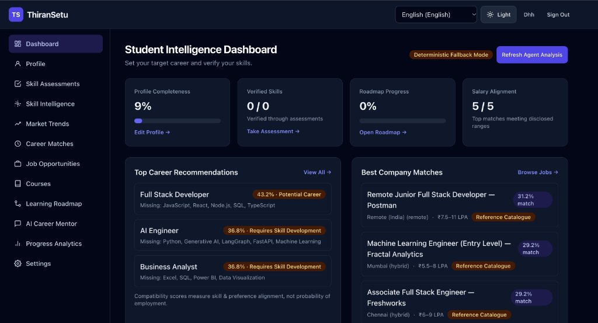
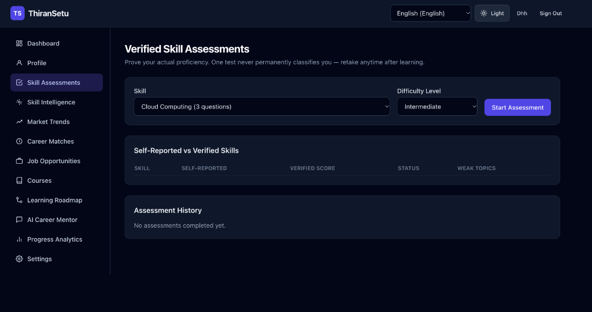
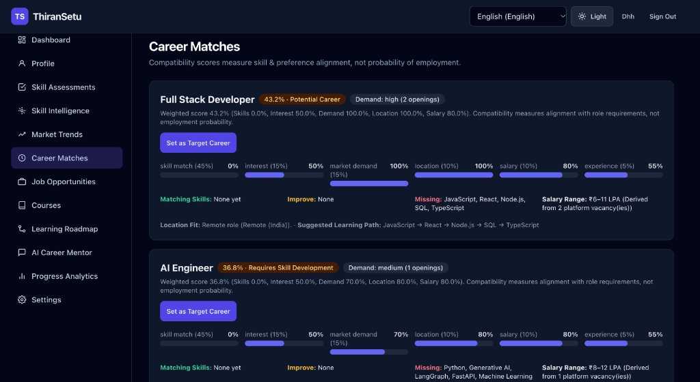
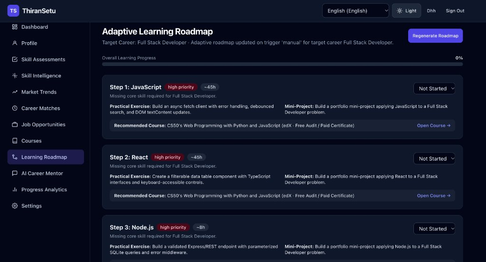

# ThiranSetu

**Bridging Skills. Connecting Opportunities.**

ThiranSetu is an Agentic AI-powered career intelligence platform that connects verified skill assessment, industry insights, personalized career recommendations, company-based job matching and multilingual learning pathways.

[](https://fastapi.tiangolo.com/)
[](https://langchain-ai.github.io/langgraph/)
[](https://react.dev/)
[](https://www.typescriptlang.org/)
[](https://tailwindcss.com/)
[](https://www.sqlalchemy.org/)
[](https://ai.google.dev/)
[](#supported-languages)

---

## Table of Contents

- [Application Preview](#application-preview)
- [Project Overview](#project-overview)
- [Key Features](#key-features)
- [Seven-Agent Architecture](#seven-agent-architecture)
- [Technology Stack](#technology-stack)
- [Project Structure](#project-structure)
- [Installation and Setup](#installation-and-setup)
- [Environment Variables](#environment-variables)
- [Testing and Quality Assurance](#testing-and-quality-assurance)
- [Security and Data Integrity](#security-and-data-integrity)
- [Supported Languages](#supported-languages)
- [Roadmap](#roadmap)
- [GitHub Repository Presentation](#github-repository-presentation)

---

## Application Preview

### Dashboard



The **Student Intelligence Dashboard** provides an immediate overview of profile completeness, verified skill counts, learning roadmap progress, salary alignment, top career recommendations, and active agent-run mode, with direct links to assessments, profile updates, and career exploration.

### Skill Assessment



The **Verified Skill Assessments** workspace lets students choose a technical skill and difficulty level (`Beginner`, `Intermediate`, `Advanced`), complete structured evaluations, compare self-reported vs. verified proficiency scores, inspect weak-topic diagnostics, and retake assessments after upskilling.

### Career Recommendations



The **Career Matches** view ranks career paths using a transparent 6-component weighted compatibility breakdown (`skill_match`, `interest`, `market_demand`, `location`, `salary`, `experience`), highlighting matching skills, skills to improve, missing skills, and suggested learning paths.

### Learning Roadmap



The **Adaptive Learning Roadmap** translates verified skill gaps and target-career or company-vacancy requirements into prioritized learning steps, complete with estimated study hours, practical exercises, portfolio mini-projects, verified course links, and progress status tracking.

---

## Project Overview

Students and early-career professionals often struggle with fragmented career guidance: self-reported resumes rarely reflect verified proficiency, generic job boards do not explain why a candidate misses a role's mandatory requirements, and online course catalogues seldom connect directly to measurable skill gaps or regional language needs.

**ThiranSetu** addresses this end-to-end journey in one unified platform:

1. **Skill Assessment**: Verifies technical proficiency through leveled assessments rather than relying solely on self-reported claims.
2. **Skill-Gap Identification**: Classifies strong, weak, missing, unverified, emerging, and declining/outdated skills against target roles and synced company requirements.
3. **Industry Intelligence**: Tracks demand counts, emerging technologies, and declining skill indicators from verified platform vacancies and curated skill taxonomy data.
4. **Career Recommendations**: Computes explainable 6-component career compatibility scores across supported roles.
5. **Company-Based Job Matching**: Extracts mandatory/preferred skills, education, experience, location, work mode, and disclosed salary from company job descriptions, scoring student readiness per vacancy.
6. **Personalized Course Discovery**: Matches missing skills to verified direct-URL courses with explicit teaching, audio, and subtitle language metadata.
7. **Adaptive Learning Roadmaps**: Persists ordered, priority-ranked steps that update when assessments, target roles, or company requirements change.
8. **AI Career Mentor**: Provides context-aware guidance backed by Google Gemini with a deterministic offline fallback.

---

## Key Features

1. **Student Profile Management**: Captures education, college, graduation year, technical and soft skills, projects, certifications, experience, current vs. preferred job locations, relocation willingness, work mode (`remote`, `hybrid`, `onsite`, `any`), expected/minimum salary, and separate UI vs. learning language preferences.
2. **Skill Assessment and Proficiency Analysis**: Evaluates skills across `beginner`, `intermediate`, and `advanced` tiers with topic-level diagnostics, reassessment recency weighting, and complete attempt history.
3. **Skill Gap Identification**: Distinguishes verified strong skills (`>= 70%`), weak skills (`< 70%`), self-reported unverified skills, missing role/vacancy skills, and evidence-backed outdated/declining skills.
4. **Industry and Market Intelligence**: Aggregates skill demand and role demand from verified, non-synthetic platform vacancies alongside curated emerging, stable, and declining skill taxonomy entries.
5. **AI-Powered Career Recommendations**: Ranks career paths transparently using weighted skill match (45%), interest (15%), market demand (15%), location fit (10%), salary fit (10%), and experience (5%), explicitly framed as compatibility rather than hiring probability.
6. **Company-Based Job Matching**: Parses pasted job descriptions (`POST /api/jobs/extract`), lets users edit extracted requirements before saving (`POST /api/jobs`), computes match scores, opens official `apply_url` links externally, and tracks application statuses (`saved`, `applied`, `interviewing`, `offer`, `rejected`).
7. **Mandatory and Preferred Skill Analysis**: Separates mandatory vs. preferred skills during job description extraction, vacancy requirement synchronization, and job compatibility scoring.
8. **Course Discovery**: Filters courses by skill, platform, teaching language, audio language, subtitle language, price (`free`/`paid`), difficulty, duration, rating, and verified direct-URL availability (`verified_only`).
9. **Multilingual Learning Support**: Tracks primary teaching language, audio languages, and subtitle languages independently, and compares multilingual course equivalents while distinguishing outcome-backed `syllabus_verified` equivalence from `potential_skill_overlap`.
10. **Personalized Learning Roadmap**: Generates and persists prioritized steps (`high`, `medium`, `low`) with practical exercises, mini-projects, and verified course recommendations.
11. **AI Career Mentor**: Answers career, skill-gap, interview, and learning questions using the student's latest orchestrator state via Gemini (`gemini-2.5-flash`) with deterministic fallback.
12. **Learning Progress Tracking**: Updates step completion (`not_started`, `in_progress`, `completed`), recalculates overall roadmap progress percentage, and flags skills for reassessment upon step completion.

---

## Seven-Agent Architecture

ThiranSetu orchestrates seven specialized agents and two conditional routing nodes in a **LangGraph `StateGraph`** (`backend/app/agents/orchestrator.py`), sharing a typed `OrchestratorState` (`backend/app/agents/state.py`) and recording an ordered execution trace (`AgentRun`) for every run.

```mermaid
flowchart LR
    UI["React + TypeScript SPA"] -->|REST JSON + Bearer JWT| API["FastAPI Backend"]
    API --> DB[("SQLite / SQLAlchemy")]
    API --> Orch["LangGraph StateGraph Orchestrator"]

    Orch --> A1["1. Skill Assessment Agent"]
    A1 -->|"trigger == 'job_added'"| Sync["Vacancy Requirement Sync<br/>(VacancyRequirements -> state)"]
    A1 -->|"standard trigger"| A2["2. Skill Intelligence Agent"]
    Sync --> A2
    A2 -->|"needs_targeted_practice == true"| TP["Targeted Practice Escalation"]
    TP --> A3["3. Market Intelligence Agent"]
    A2 -->|"needs_targeted_practice == false"| A3
    A3 --> A4["4. Career Matching Agent"]
    A4 --> A5["5. Job Requirement & Opportunity Agent"]
    A5 --> A6["6. Course Discovery & Learning Path Agent"]
    A6 --> A7["7. AI Career Mentor Agent"]

    A7 --> Gem["Gemini Client (300s Cache + Deterministic Fallback)"]
```



### Agent Responsibilities and Collaboration

| Node / Agent | Module | Role & Shared-State Exchange |
| :--- | :--- | :--- |
| **1. Skill Assessment Agent** | `backend/app/agents/skill_assessment.py` | Evaluates verified assessment scores and weak topics; sets `needs_targeted_practice` when any verified skill scores below `60%`. |
| **Vacancy Requirement Sync** *(conditional)* | `backend/app/agents/orchestrator.py` | Triggered on `trigger == "job_added"`; extracts, canonicalizes, and Pydantic-validates `VacancyRequirements` into `OrchestratorState["vacancy_requirements"]`. |
| **2. Skill Intelligence Agent** | `backend/app/agents/skill_intelligence.py` | Classifies strong, weak, missing, unverified, emerging, and outdated/declining skills; consumes `vacancy_requirements` to populate `vacancy_gaps` and prioritize missing mandatory skills. |
| **Targeted Practice Escalation** *(conditional)* | `backend/app/agents/orchestrator.py` | Appends priority retake preparation directives to `skill_intelligence["targeted_practice"]` when `needs_targeted_practice` is `True`. |
| **3. Market Intelligence Agent** | `backend/app/agents/market_intelligence.py` | Computes skill and role demand strictly from verified, non-synthetic vacancies (`is_demo == False`) and curated skill taxonomy trends. |
| **4. Career Matching Agent** | `backend/app/agents/career_matching.py` | Ranks career roles using the 6-component weighted score, verified non-synthetic vacancy counts, and `vacancy_requirements` skill overlap. |
| **5. Job Requirement & Opportunity Agent** | `backend/app/agents/job_matching.py` | Filters out `is_demo == True`, unverified, and expired vacancies; scores remaining verified jobs against student skills, location, work mode, experience, and salary. |
| **6. Course Discovery & Learning Path Agent** | `backend/app/agents/course_discovery.py` | Consumes `skill_intelligence` (`weak`, `missing`, `vacancy_gaps.mandatory_missing`) and `careers` to recommend verified direct-URL courses and build `roadmap` steps. |
| **7. AI Career Mentor Agent** | `backend/app/agents/career_mentor.py` | Synthesizes `skill_intelligence`, `careers`, `top_jobs`, and `roadmap` into `mentor_brief` and powers interactive `/api/mentor/chat` responses. |

---

## Technology Stack

- **Frontend**: React 18, TypeScript 5.6, Vite 5, Tailwind CSS 3, React Router v6, TanStack React Query v5, `i18next`, `react-i18next`
- **Backend**: Python 3.13, FastAPI, Uvicorn, Pydantic v2, `pydantic-settings`, `httpx`
- **Database**: SQLite with SQLAlchemy 2 ORM (`backend/app/db/models.py`, `backend/app/db/session.py`)
- **AI and Agent Orchestration**: LangGraph (`StateGraph`), Google Gemini API (`gemini-2.5-flash` via `httpx` in `backend/app/services/gemini_client.py` with SHA-256 response caching and deterministic fallback)
- **Data Processing**: Deterministic regex/taxonomy job description requirement extraction (`extract_requirements_from_text`), skill canonicalization (`canonical_skill`), and weighted scoring (`backend/app/services/scoring.py`)
- **Visualization**: Recharts (readiness trend, skill proficiency, and market demand charts)
- **Testing and Quality Assurance**: `pytest`, `ruff`, Vitest, React Testing Library, `@testing-library/user-event`, `jsdom`, `axe-core`, TypeScript (`tsc -b --noEmit`), ESLint 9 (`typescript-eslint`, `eslint-plugin-react-hooks`)

---

## Project Structure

```text
ThiranSetu/
├── .env.example
├── .gitignore
├── README.md
├── docs/
│   ├── API.md
│   ├── EVALUATION_AND_ALIGNMENT.md
│   └── screenshots/
│       ├── dashboard.jpg
│       ├── skill-assessment.png
│       ├── career-recommendations.jpg
│       └── learning-roadmap.jpg
├── backend/
│   ├── pyproject.toml
│   ├── requirements.txt
│   ├── requirements-dev.txt
│   ├── app/
│   │   ├── main.py
│   │   ├── core/
│   │   │   ├── config.py
│   │   │   ├── rate_limit.py
│   │   │   └── security.py
│   │   ├── db/
│   │   │   ├── models.py
│   │   │   ├── seed.py
│   │   │   └── session.py
│   │   ├── data/
│   │   │   ├── catalog.py
│   │   │   ├── courses_demo.json
│   │   │   ├── jobs_demo.json
│   │   │   ├── questions_bank.json
│   │   │   ├── roles.json
│   │   │   └── skills.json
│   │   ├── schemas/
│   │   │   └── all.py
│   │   ├── services/
│   │   │   ├── gemini_client.py
│   │   │   ├── job_ingestion.py
│   │   │   └── scoring.py
│   │   ├── agents/
│   │   │   ├── career_matching.py
│   │   │   ├── career_mentor.py
│   │   │   ├── course_discovery.py
│   │   │   ├── job_matching.py
│   │   │   ├── market_intelligence.py
│   │   │   ├── orchestrator.py
│   │   │   ├── skill_assessment.py
│   │   │   ├── skill_intelligence.py
│   │   │   └── state.py
│   │   └── api/
│   │       ├── deps.py
│   │       └── routers/
│   │           ├── assessments.py
│   │           ├── auth.py
│   │           ├── insights.py
│   │           ├── jobs.py
│   │           ├── learning.py
│   │           └── profile.py
│   └── tests/
│       ├── conftest.py
│       ├── test_assessments_and_intelligence.py
│       ├── test_auth_and_profile.py
│       ├── test_enhancements.py
│       └── test_jobs_careers_courses.py
└── frontend/
    ├── eslint.config.js
    ├── index.html
    ├── package.json
    ├── postcss.config.js
    ├── tailwind.config.ts
    ├── tsconfig.json
    ├── vite.config.ts
    ├── public/
    │   └── favicon.svg
    └── src/
        ├── App.tsx
        ├── main.tsx
        ├── api/
        ├── components/
        ├── hooks/
        ├── i18n/
        │   └── locales/
        ├── lib/
        ├── pages/
        └── test/
```

---

## Installation and Setup

### Prerequisites
- Python 3.11+
- Node.js 20+ and `npm`

### 1. Environment Configuration
```bash
cp .env.example backend/.env
```
Edit `backend/.env` and set a strong random `JWT_SECRET` (at least 32 characters). Never commit `backend/.env`.

### 2. Backend Setup and Startup
```bash
cd backend
python3 -m venv .venv
source .venv/bin/activate
pip install -r requirements-dev.txt
uvicorn app.main:app --host 127.0.0.1 --port 8000
```
- Database tables are initialized automatically on startup via `init_db()` in FastAPI's lifespan handler (`backend/app/main.py`).
- Backend API: `http://127.0.0.1:8000`
- OpenAPI Docs: `http://127.0.0.1:8000/docs`
- Health Check: `http://127.0.0.1:8000/api/health`

### 3. Frontend Setup and Startup
```bash
cd frontend
npm install
npm run dev -- --host 127.0.0.1 --port 5173
```
- Local Application URL: `http://127.0.0.1:5173/`

### 4. Production Frontend Build
```bash
cd frontend
npm run build
```

---

## Environment Variables

| Variable | Purpose | Required | Safe Example Value |
| :--- | :--- | :--- | :--- |
| `ENVIRONMENT` | Runtime environment (`development`, `test`, `production`) | Optional | `development` |
| `DATABASE_URL` | SQLAlchemy database connection URL | Optional | `sqlite:///./thiransetu.db` |
| `JWT_SECRET` | Signing secret for HS256 JWT access and refresh tokens | Required (prod) | `replace-with-at-least-32-random-characters` |
| `CORS_ORIGINS` | Comma-separated allowed frontend origins | Optional | `http://localhost:5173,http://127.0.0.1:5173` |
| `GEMINI_API_KEY` | Google Gemini API key (deterministic fallback runs if omitted) | Optional | `your-gemini-api-key-here` |
| `GEMINI_MODEL` | Gemini model identifier | Optional | `gemini-2.5-flash` |
| `LLM_ENABLED` | Enable or disable external Gemini API calls | Optional | `true` |
| `REDIS_URL` | Redis URL for distributed rate limiting (`503` fail-closed in prod if unreachable) | Required (prod) | `redis://127.0.0.1:6379/0` |
| `JOB_FEED_URL` | Permitted `https://` JSON job feed URL for `/api/jobs/sync` | Optional | `https://example.com/jobs.json` |
| `TRUST_PROXY_HEADERS` | Whether to trust `X-Forwarded-For` client IP headers | Optional | `false` |
| `SEED_DEMO_DATA` | Seeds reference demo records on empty DB (tagged `Synthetic Demo`, excluded from live results) | Optional | `true` |

---

## Testing and Quality Assurance

### Backend (`pytest`, `compileall`, `ruff`)
```bash
cd backend
.venv/bin/python -m compileall -q app
.venv/bin/python -m pytest -v
.venv/bin/ruff check app tests
```
Covers authentication, refresh-token rotation and reuse detection, CSRF enforcement, rate limiting, user data isolation, skill assessments, synthetic vacancy exclusion, course verification, and LangGraph agent collaboration.

### Frontend (`vitest`, `tsc`, `eslint`, `axe-core`, `vite build`)
```bash
cd frontend
npm run test
npm run typecheck
npm run lint
npm run build
```
Covers i18n locale parity across all 8 languages, API error mapping, in-memory token handling, `JobAddForm` requirement extraction, orchestrator trace rendering, `axe-core` accessibility checks, TypeScript compilation, ESLint rules, and production bundling.

---

## Security and Data Integrity

> "ThiranSetu prioritizes reliable, source-backed information and transparent verification. Unavailable or undisclosed information is identified clearly rather than being presented as confirmed data."

- **Authentication & Password Hashing**: Uses `scrypt` salted password hashing (`backend/app/core/security.py`).
- **Token Handling & CSRF Protection**: Short-lived HS256 JWT access tokens are kept strictly in memory (`frontend/src/api/client.ts`), paired with `HttpOnly` refresh-token rotation, token-version/JTI reuse detection, and double-submit `ts_csrf` cookie + `X-CSRF-Token` header verification.
- **Authorization & Data Isolation**: Protected endpoints require `get_current_user` (`backend/app/api/deps.py`) and scope database queries by `user.id`.
- **Rate Limiting**: Protects sensitive auth and AI mentor endpoints using `backend/app/core/rate_limit.py`, failing closed with HTTP `503` in production if Redis is unreachable.
- **Input & External URL Validation**: Enforces Pydantic v2 schemas (`backend/app/schemas/all.py`), requires `https://` for external `JOB_FEED_URL` and `apply_url` links, and sanitizes URLs on the frontend via `safeUrl()`.
- **Environment-Based Secrets**: All secrets (`JWT_SECRET`, `GEMINI_API_KEY`, `REDIS_URL`) are loaded from environment variables and excluded from Git via `.gitignore`.
- **Synthetic Data & Course Verification**: `is_demo=True` vacancies are tagged `Synthetic Demo` and excluded from `/api/jobs`, `/api/jobs/{id}`, `job_matching`, `career_matching`, `market_intelligence`, and `/api/dashboard`. Courses without verified direct `https://` URLs are excluded from verified recommendations, roadmap steps, and multilingual equivalence matching. Undisclosed salaries and unverified ratings render as `Not Disclosed` and `Not Verified`.

---

## Supported Languages

ThiranSetu supports **8 application interface languages** (`frontend/src/i18n/locales/`), keeping the **ThiranSetu** brand name untranslated across every locale:

- English (`en`)
- Tamil (`ta`)
- Hindi (`hi`)
- Telugu (`te`)
- Kannada (`kn`)
- Malayalam (`ml`)
- Bengali (`bn`)
- Marathi (`mr`)

**Interface Language vs. Course Language**: The application UI language (`app_language`) and preferred course learning language (`learning_language`) are configured independently. Course search and discovery track teaching language, audio languages, and subtitle languages separately.

---

## Roadmap

### Implemented
- Full-stack FastAPI + React + TypeScript + SQLAlchemy platform with 16 frontend routes.
- LangGraph 7-agent orchestrator with `Vacancy Requirement Sync` and `Targeted Practice Escalation`.
- `scrypt` auth, in-memory JWTs, refresh-token rotation, CSRF protection, and Redis/in-memory rate limiting.
- Synthetic vacancy exclusion (`is_demo=True`), manual JD extraction (`Pending Verification`), and `https://` feed sync.
- Verified direct-URL course filtering and outcome-based vs. skill-overlap multilingual equivalence.
- 8-language UI (`i18n`), dark/light theme, Recharts analytics, ESLint 9, `ruff`, `pytest`, `vitest`, and `axe-core` checks.

### In Progress
- Expanding verified direct-URL regional-language course coverage across all 8 supported languages.
- Automated verification workflows for manually submitted company vacancies.

### Planned Enhancements
- PostgreSQL production migration support and Alembic schema migrations.
- End-to-end Playwright browser test suite covering full authenticated multi-page flows.

---

## GitHub Repository Presentation

- **Suggested Repository Description**:
  `Agentic AI-powered skill intelligence, career recommendation, company-based job matching and multilingual learning platform.`
- **Suggested Repository Topics**:
  `agentic-ai`, `career-intelligence`, `skill-assessment`, `career-recommendation`, `job-matching`, `langgraph`, `fastapi`, `react`, `typescript`, `multilingual-learning`
