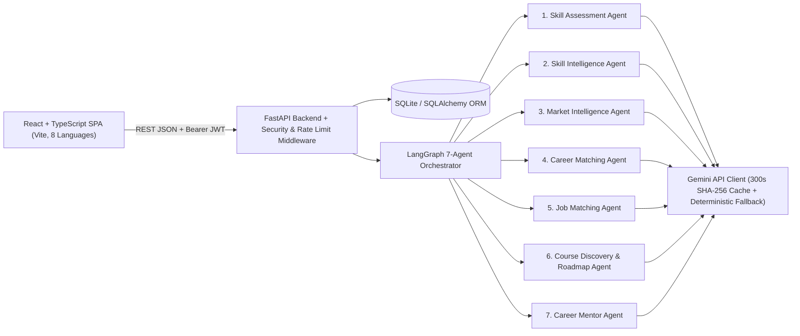

# ThiranSetu

**Bridging Skills. Connecting Opportunities.**

ThiranSetu is an agentic AI-powered skill intelligence, career recommendation, company requirement-based job matching, and multilingual learning platform built with FastAPI, LangGraph, SQLAlchemy, React, TypeScript, and Tailwind CSS.

> [!NOTE]
> ThiranSetu uses a curated demonstration dataset (`is_demo: true`) for sample company vacancies, market intelligence snapshots, and courses when external live feeds are not configured. Demonstration records are explicitly labeled in the UI and API responses, and missing salary or rating fields are shown as `Not Disclosed` / `Not Verified`.

---

## Key Capabilities

1. **Student Profile & Preferences (`MODULE 1`)**: Secure registration/login (scrypt password hashing + HS256 JWT with token-version revocation), separate current vs. preferred job locations, relocation and work mode preferences, expected & minimum acceptable salary, education, projects, certifications, and preferred learning language.
2. **Verified Skill Assessment Engine (`MODULE 2`)**: Skill-specific assessments across beginner, intermediate, and advanced levels (Python, SQL, Excel, Power BI, Machine Learning, JavaScript, Cloud, Cybersecurity) with automatic scoring, strong/weak topic diagnostics, assessment history, and reassessment recency weighting.
3. **Skill Intelligence & Obsolescence (`MODULE 3`)**: Distinguishes strong, weak, missing, emerging, stable, and declining-demand skills using industry context rather than skill age alone.
4. **Market Intelligence (`MODULE 4`)**: Tracks high-demand, emerging, stable, and declining skills with explicit source, date, geographical scope, and demonstration-data labeling.
5. **Dynamic Career Recommendation (`MODULE 5`)**: Scores and ranks career paths (e.g., Data Analyst, Data Scientist, Machine Learning Engineer, AI Engineer, Python Developer, Full Stack Developer, Business Analyst, Cloud Engineer, Cybersecurity Analyst) using a transparent 6-component compatibility formula (never framed as employment probability).
6. **Company Requirement-Based Job Matching (`MODULE 6`)**: Extracts mandatory vs. preferred skills, education, experience, location, work mode, and salary from vacancies; computes explainable job compatibility; links missing skills to targeted courses; and provides an external `Apply Now` link (`apply_url`) plus application status tracking.
7. **Multilingual Course Discovery & Adaptive Roadmap**: Recommends free and paid courses across English and 7 Indian languages (`en`, `ta`, `hi`, `te`, `kn`, `ml`, `bn`, `mr`) with syllabus-verified multilingual equivalence and a 4-phase adaptive learning roadmap.
8. **AI Career Mentor**: Context-aware mentor backed by Gemini (with deterministic offline fallback) for career guidance, interview prep, and skill-gap planning.

---

## System Architecture



### Multi-Agent Workflow

- `backend/app/agents/orchestrator.py` coordinates a `StateGraph` across the specialized agents (`skill_assessment`, `skill_intelligence`, `market_intelligence`, `career_matching`, `job_matching`, `course_discovery`, `career_mentor`).
- Conditional routing (`needs_targeted_practice`) checks verified assessment scores and weak topics so students with skill gaps receive targeted practice and course recommendations before finalizing roadmap steps.
- `backend/app/services/gemini_client.py` caches responses for 300 seconds by SHA-256 prompt digest and falls back deterministically when `GEMINI_API_KEY` is absent or an external request fails.

---

## Project Structure

```text
ThiranSetu/
├── .env.example
├── .gitignore
├── README.md
├── docs/
│   ├── API.md
│   └── EVALUATION_AND_ALIGNMENT.md
├── backend/
│   ├── pyproject.toml
│   ├── requirements.txt
│   ├── requirements-dev.txt
│   ├── app/
│   │   ├── main.py
│   │   ├── core/          # config, scrypt+JWT security, rate limiting & headers
│   │   ├── db/            # SQLAlchemy session, models, seed data
│   │   ├── data/          # skills, roles, jobs_demo, courses_demo, questions_bank
│   │   ├── schemas/       # Pydantic request/response schemas
│   │   ├── services/      # Gemini client + deterministic scoring & JD extractor
│   │   ├── agents/        # 7 specialized agents + LangGraph orchestrator
│   │   └── api/routers/   # auth, profile, assessments, insights, jobs, learning
│   └── tests/             # pytest API & integration suite
└── frontend/
    ├── package.json
    ├── vite.config.ts
    └── src/
        ├── api/           # typed fetch client + TS types
        ├── components/    # UI primitives, AppShell, ProtectedRoute
        ├── hooks/         # useAuth, useTheme
        ├── i18n/          # lazy-loaded 8-language i18n setup + locales/
        ├── lib/           # formatting & error helpers
        ├── pages/         # 16 route pages (Landing, Dashboard, Jobs, Mentor, etc.)
        └── test/          # Vitest + React Testing Library suite
```

---

## Local Setup & Running

### Prerequisites

- Python 3.11+ (tested with `.venv` in `backend/.venv`)
- Node.js 20+ and `npm`

### 1. Environment Configuration

Copy `.env.example` to `backend/.env` (never commit `.env` files):

```bash
cp .env.example backend/.env
```

Key variables in `backend/.env`:

- `GEMINI_API_KEY`: Optional Gemini API key. If omitted or unavailable, ThiranSetu automatically uses deterministic fallback responses.
- `SECRET_KEY`: Random secret string for signing HS256 JWTs.
- `DATABASE_URL`: Defaults to `sqlite:///./thiransetu.db`.
- `ALLOWED_ORIGINS`: Comma-separated frontend origins (e.g. `http://localhost:5173`).

### 2. Backend Setup & Run

```bash
cd backend
python3 -m venv .venv
source .venv/bin/activate
pip install -r requirements-dev.txt
uvicorn app.main:app --reload --port 8000
```

- Backend API: `http://localhost:8000`
- Interactive OpenAPI Docs: `http://localhost:8000/docs`
- Health Check: `http://localhost:8000/api/health`

### 3. Frontend Setup & Run

```bash
cd frontend
npm install
npm run dev
```

- Frontend App: `http://localhost:5173`

---

## Testing & Quality Checks

### Backend (`pytest` + `ruff`)

```bash
cd backend
.venv/bin/pytest -v
.venv/bin/ruff check app tests
```

### Frontend (`vitest` + TypeScript + Vite build)

```bash
cd frontend
npm test
npm run build
```

---

## Data Integrity & Responsible AI Policy

- **No Fabricated Data**: Demonstration jobs (`backend/app/data/jobs_demo.json`), courses (`backend/app/data/courses_demo.json`), and market indicators are explicitly tagged (`is_demo: true` / Demonstration Data).
- **Transparent Missing Values**: Undisclosed salaries render as `Not Disclosed`; unverified course ratings render as `Not Verified`.
- **Explainable Scoring**: Career and job compatibility scores show exact component breakdowns and missing/partial skills, and are explicitly framed as skill-alignment metrics rather than hiring probabilities.
- **No False Applications**: `Apply Now` opens the official `apply_url` externally; ThiranSetu never claims to submit an application to an external employer portal on the student's behalf.
