# ThiranSetu

**Bridging Skills. Connecting Opportunities.**

[](https://fastapi.tiangolo.com/)
[](https://langchain-ai.github.io/langgraph/)
[](https://react.dev/)
[](#testing-linting--build-verification)
[](#eight-language-support)

**ThiranSetu** is an agentic AI-powered skill intelligence, career recommendation, company requirement-based job matching, and multilingual learning platform. It guides learners from verified skill assessments through gap diagnostics, explainable career rankings, structured job-description matching, and adaptive learning roadmaps.

> [!IMPORTANT]
> **Strict Data Integrity & Verification Policy:** ThiranSetu never presents synthetic demonstration records as genuine company vacancies, never invents undisclosed salaries or course ratings, and excludes unverified courses without direct `https://` URLs from verified recommendations.

---

## Table of Contents

- [Key Capabilities](#key-capabilities)
- [Multi-Agent Architecture](#multi-agent-architecture)
- [Data Integrity & Verification](#data-integrity--verification)
- [Eight-Language Support & Accessibility](#eight-language-support--accessibility)
- [Tech Stack & Project Structure](#tech-stack--project-structure)
- [API Overview](#api-overview)
- [Local Setup & Running](#local-setup--running)
- [Environment Variables](#environment-variables)
- [Testing, Linting & Build Verification](#testing-linting--build-verification)

---

## Key Capabilities

1. **Security-First Authentication & Student Profile**
   - `scrypt` password hashing, short-lived HS256 JWT access tokens held strictly in memory (never `localStorage`), `HttpOnly` refresh-token rotation with token-version/reuse detection, and CSRF double-submit cookie + `X-CSRF-Token` header enforcement.
   - Rate limiting with in-memory development fallback and fail-closed (`503`) Redis enforcement in production (`ENVIRONMENT=production`).
   - Captures education, technical & soft skills, projects, certifications, current vs. preferred locations, relocation & work-mode preferences, salary expectations, and separate app vs. learning languages.

2. **Verified Skill Assessment Engine**
   - Skill-specific assessments across beginner, intermediate, and advanced levels with automatic scoring, strong/weak topic diagnostics, assessment history, and reassessment recency weighting.

3. **Skill Intelligence & Evidence-Backed Obsolescence Detection**
   - Classifies skills into strong, weak, missing, emerging, stable, and declining/outdated categories using industry context and evidence rather than skill age alone.
   - Consumes synced company vacancy requirements (`vacancy_requirements`) from shared orchestration state to prioritize missing mandatory skills.

4. **Dynamic 6-Component Career Recommendation Engine**
   - Ranks career roles using a transparent, deterministic 6-component weighted score (`skill_match`, `interest`, `market_demand`, `location`, `salary`, `experience`)—explicitly framed as skill and preference alignment rather than hiring probability.

5. **Company Requirement-Based Job Matching & JD Extraction**
   - Parses pasted company job descriptions to extract mandatory skills, preferred skills, education, minimum experience, location, work mode, and explicitly stated salary ranges (rendering `Not Disclosed` when absent).
   - Lets users review and edit extracted skills before saving, links skill gaps directly to verified courses, opens official `apply_url` links externally, and tracks application statuses (`saved`, `applied`, `interviewing`, `offer`, `rejected`).

6. **Verified Course Discovery & Adaptive Learning Roadmap**
   - Separately tracks teaching language, audio languages, and subtitle languages across verified courses.
   - Distinguishes **syllabus-verified equivalents** (backed by shared learning outcomes) from **potential skill overlap** (skill-tag overlap without verified outcome parity).
   - Generates a prioritized, persistent learning roadmap with practical exercises, portfolio mini-projects, and reassessment prompts upon step completion.

7. **AI Career Mentor**
   - Context-aware career mentor powered by Google Gemini (`gemini-2.5-flash` with a 300-second SHA-256 prompt cache) and automatic deterministic offline fallback when `GEMINI_API_KEY` is omitted or unavailable.

---

## Multi-Agent Architecture

ThiranSetu coordinates **7 specialized AI agents** and **2 conditional escalation/sync nodes** through a LangGraph `StateGraph` (`backend/app/agents/orchestrator.py`), passing structured `OrchestratorState` (`backend/app/agents/state.py`) across nodes and recording execution traces:

```mermaid
flowchart LR
    UI["React + TypeScript SPA<br/>(Vite, Tailwind CSS, 8 Languages)"] -->|REST JSON + Bearer JWT| API["FastAPI Backend<br/>(Security, CSRF & Rate-Limit Middleware)"]
    API --> DB[("SQLite / SQLAlchemy ORM")]
    API --> Orch["LangGraph StateGraph Orchestrator"]

    Orch --> A1["1. Skill Assessment Agent"]
    A1 -->|"trigger == 'job_added'"| Sync["Vacancy Requirement Sync<br/>(Pydantic-validated state)"]
    A1 -->|standard flow| A2["2. Skill Intelligence Agent"]
    Sync --> A2
    A2 -->|"score < 60%"| TP["Targeted Practice Escalation"]
    TP --> A3["3. Market Intelligence Agent"]
    A2 -->|">= 60%"| A3
    A3 --> A4["4. Career Matching Agent"]
    A4 --> A5["5. Job Requirement & Opportunity Agent"]
    A5 --> A6["6. Course Discovery & Roadmap Agent"]
    A6 --> A7["7. AI Career Mentor Agent"]

    A7 --> Gem["Gemini API Client<br/>(300s Cache + Deterministic Fallback)"]
```



### Real Agent Collaboration Flow (`Vacancy Requirement Sync`)
- When a company vacancy is added (`trigger="job_added"`), `_vacancy_requirement_sync_node` extracts, canonicalizes, and validates `VacancyRequirements` (mandatory skills, preferred skills, education, minimum experience, location, work mode) and stores them in `OrchestratorState["vacancy_requirements"]`.
- **Skill Intelligence Agent** consumes `vacancy_requirements` to compute `vacancy_gaps` and surface missing mandatory skills at the top of `missing`.
- **Career Matching Agent** factors synced vacancy skill overlap into career demand alignment.
- **Course Discovery Agent** prioritizes `vacancy_gaps.mandatory_missing` when selecting `recommended_courses` and generating `roadmap.steps`.

---

## Data Integrity & Verification

- **Synthetic Vacancy Exclusion**: Curated sample records in `backend/app/data/jobs_demo.json` (`is_demo=True`) are seeded with `verification_status="Synthetic Demo"` and `last_verified_date=None`. They are strictly excluded from `/api/jobs`, `/api/jobs/{id}` (`404`), `job_matching`, `career_matching`, `market_intelligence`, and `/api/dashboard`.
- **Job Verification Lifecycle**: Manually submitted vacancies are saved with `is_demo=False` and `verification_status="Pending Verification"`. Only non-synthetic vacancies with `Verified` status, an `https://` `apply_url`, a non-empty `source`, a `last_verified_date`, and a non-expired deadline appear in verified top-job matches.
- **Permitted External Job Feed**: `POST /api/jobs/sync` supports a configured `https://` JSON employer/board feed (`JOB_FEED_URL`) and never scrapes websites or fabricates live listings when unconfigured.
- **Course Catalogue Verification**: `is_verified_course()` requires a direct `https://` URL (blocking `youtube.com/results` search URLs and `Pending Verification` entries) plus complete title, provider, teaching language, audio, and subtitle metadata. Unverified syllabus references are excluded from `/api/courses/recommended`, `roadmap` steps, `/api/courses/{id}/equivalents`, and `GET /api/courses?verified_only=true`.

---

## Eight-Language Support & Accessibility

- **8 Application Languages**: English (`en`), Tamil (`ta`), Hindi (`hi`), Telugu (`te`), Kannada (`kn`), Malayalam (`ml`), Bengali (`bn`), and Marathi (`mr`), stored in `frontend/src/i18n/locales/` with verified key parity across all 104 translation keys. The brand name **ThiranSetu** remains untranslated across all locales.
- **Separation of Concerns**: Application UI language (`app_language`) and preferred course learning language (`learning_language`) are managed independently.
- **Accessibility**: Semantic landmarks, accessible form controls (`aria-invalid`, `aria-describedby`, `role="alert"` error messages on `Input`, `Select`, and `TextArea`), labeled `ProgressBar` indicators, `Escape`-key handling on the mobile navigation drawer, and automated `axe-core` checks in Vitest.

---

## Tech Stack & Project Structure

| Layer | Technologies |
| :--- | :--- |
| **Backend** | Python 3.13, FastAPI, SQLAlchemy 2, SQLite, Pydantic v2, LangGraph, `httpx`, `ruff`, `pytest` |
| **Frontend** | React 18, TypeScript 5.6, Vite 5, Tailwind CSS 3, TanStack Query v5, React Router v6, `i18next`, Recharts |
| **Testing & Lint** | `pytest`, `ruff`, `vitest`, React Testing Library, `axe-core`, `tsc`, ESLint 9 (`typescript-eslint`, `eslint-plugin-react-hooks`) |

```text
ThiranSetu/
├── .env.example
├── .gitignore
├── README.md
├── docs/
│   ├── API.md
│   └── EVALUATION_AND_ALIGNMENT.md
├── backend/
│   ├── pyproject.toml
│   ├── requirements.txt
│   ├── requirements-dev.txt
│   ├── app/
│   │   ├── main.py                # FastAPI app, CORS, security headers, lifespan
│   │   ├── core/                  # config, scrypt + HS256 JWT, CSRF, rate limiter
│   │   ├── db/                    # SQLAlchemy models, SQLite session & init, seed
│   │   ├── data/                  # skills, roles, questions_bank, jobs_demo, courses_demo
│   │   ├── schemas/               # Pydantic request/response schemas
│   │   ├── services/              # Gemini client, deterministic scoring, JD extractor, job feed sync
│   │   ├── agents/                # 7 agents + LangGraph StateGraph orchestrator
│   │   └── api/routers/           # auth, profile, assessments, insights, jobs, learning
│   └── tests/                     # pytest API, security, integrity & agent integration tests
└── frontend/
    ├── eslint.config.js
    ├── package.json
    ├── vite.config.ts
    └── src/
        ├── api/                   # typed fetch client (in-memory token + CSRF) & TS types
        ├── components/            # UI primitives, JobCard, JobAddForm, AppShell, ProtectedRoute
        ├── hooks/                 # useAuth, useTheme
        ├── i18n/                  # 8-language i18next config & locale JSONs
        ├── lib/                   # formatting & API error mapping helpers
        ├── pages/                 # 16 pages (Landing, Auth, Dashboard, Jobs, Courses, Mentor, etc.)
        └── test/                  # Vitest + RTL + axe-core test suite
```

---

## API Overview

Interactive OpenAPI documentation is available at `http://127.0.0.1:8000/docs` when the backend is running.

- **Health**: `GET /api/health`
- **Auth (`/api/auth`)**: `POST /register`, `POST /login`, `POST /refresh`, `POST /logout`, `GET /me`
- **Profile & Taxonomy**: `GET /api/profile`, `PUT /api/profile`, `GET /api/skills`, `GET /api/roles`
- **Assessments**: `GET /api/assessments/available`, `POST /api/assessments/start`, `POST /api/assessments/{attempt_id}/submit`, `GET /api/assessments/history`, `GET /api/skills/verified`
- **Orchestrator & Insights**: `POST /api/agents/run`, `GET /api/agents/latest`, `GET /api/intelligence`, `GET /api/market`, `GET /api/careers`, `PUT /api/careers/target`, `GET /api/dashboard`
- **Jobs & Applications**: `GET /api/jobs`, `GET /api/jobs/{job_id}`, `POST /api/jobs/extract`, `POST /api/jobs/sync`, `POST /api/jobs`, `GET /api/applications`, `POST /api/applications`, `PATCH /api/applications/{app_id}`, `DELETE /api/applications/{app_id}`
- **Courses, Roadmap & Mentor**: `GET /api/courses`, `GET /api/courses/recommended`, `GET /api/courses/{course_id}/equivalents`, `GET /api/roadmap`, `POST /api/roadmap/regenerate`, `PATCH /api/roadmap/steps/{step_id}`, `GET /api/mentor/suggestions`, `POST /api/mentor/chat`

---

## Local Setup & Running

### Prerequisites
- Python 3.11+ (tested on Python 3.13)
- Node.js 20+ and `npm`

### 1. Configure Environment
```bash
cp .env.example backend/.env
```
Update `JWT_SECRET` in `backend/.env` with a strong random secret (32+ characters). Never commit `backend/.env`.

### 2. Start the Backend
```bash
cd backend
python3 -m venv .venv
source .venv/bin/activate
pip install -r requirements-dev.txt
uvicorn app.main:app --host 127.0.0.1 --port 8000
```
- Backend API: `http://127.0.0.1:8000`
- Health Check: `http://127.0.0.1:8000/api/health`

### 3. Start the Frontend
```bash
cd frontend
npm install
npm run dev -- --host 127.0.0.1 --port 5173
```
- Application URL: `http://127.0.0.1:5173/`

---

## Environment Variables

| Variable | Required | Default | Description |
| :--- | :--- | :--- | :--- |
| `ENVIRONMENT` | No | `development` | `development`, `test`, or `production` |
| `DATABASE_URL` | No | `sqlite:///./thiransetu.db` | SQLAlchemy database connection URL |
| `JWT_SECRET` | Yes (prod) | Dev fallback | Signing secret for HS256 JWTs (32+ chars required in production) |
| `CORS_ORIGINS` | No | `http://localhost:5173,http://127.0.0.1:5173` | Allowed frontend origins (comma-separated) |
| `GEMINI_API_KEY` | No | `""` | Google Gemini API key; deterministic fallback runs if omitted |
| `GEMINI_MODEL` | No | `gemini-2.5-flash` | Gemini model identifier |
| `LLM_ENABLED` | No | `true` | Enable/disable Gemini calls |
| `REDIS_URL` | Yes (prod) | `""` | Redis URL for distributed rate limiting (fails closed with `503` in production if unreachable) |
| `JOB_FEED_URL` | No | `""` | Optional permitted `https://` JSON job feed URL for `/api/jobs/sync` |
| `TRUST_PROXY_HEADERS` | No | `false` | Whether to trust `X-Forwarded-For` headers |
| `SEED_DEMO_DATA` | No | `true` | Seeds reference demo records on empty DB (always tagged `is_demo=True`, `Synthetic Demo`, excluded from live results) |

---

## Testing, Linting & Build Verification

### Backend
```bash
cd backend
.venv/bin/python -m compileall -q app
.venv/bin/python -m pytest -v
.venv/bin/ruff check app tests
```
Verified output: **21 passed, 0 failed, 0 skipped** (`pytest -v`), **`All checks passed!`** (`ruff`).

### Frontend
```bash
cd frontend
npm run test
npm run typecheck
npm run lint
npm run build
```
Verified output: **11 passed, 0 failed, 0 skipped** (`vitest run`, including `axe-core` accessibility checks), **`0` TypeScript errors** (`tsc -b --noEmit`), **`0` ESLint errors/warnings** (`eslint .`), and clean production bundle (`vite build`).
